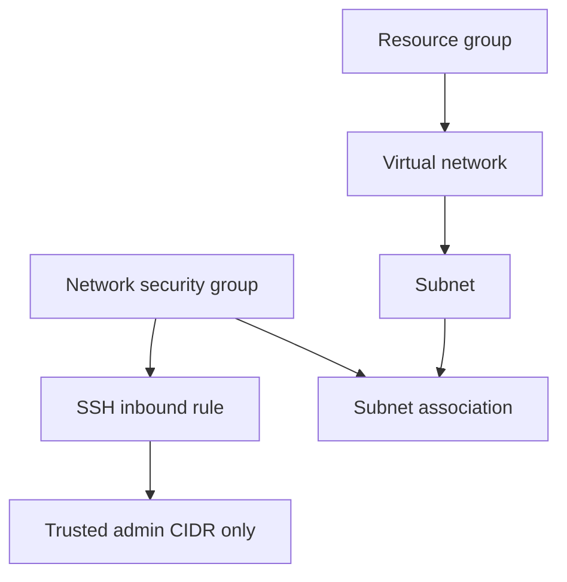

<div align="center">

# Azure Virtual Network with Terraform

**A small, reusable Azure networking lab with a restricted SSH rule**

[](https://developer.hashicorp.com/terraform)
[](https://azure.microsoft.com/)
[](https://github.com/komal324mane/azure-virtual-network-terraform/actions/workflows/terraform.yml)

</div>

This learning project provisions an Azure resource group, virtual network, subnet, and network security group using Terraform. The SSH rule is restricted to a caller-provided IPv4 CIDR and the NSG is associated with the subnet. It is a focused networking example, not a complete production landing zone.

## Architecture



## Resources

| Resource | Purpose |
| --- | --- |
| Resource group | Contains the lab resources |
| Virtual network and subnet | Provides an isolated address space |
| Network security group | Defines the subnet's inbound SSH policy |
| SSH rule | Allows TCP/22 only from `admin_source_cidr` |

## Prerequisites

- Terraform `>= 1.5`
- Azure CLI and an Azure subscription
- An authenticated Azure CLI session (`az login`) or another supported AzureRM authentication method
- A trusted public IPv4 CIDR for SSH, such as your fixed public IP with `/32`

Do not use `0.0.0.0/0` for SSH. The sample CIDR in `terraform.tfvars.example` is reserved for documentation and must be replaced with your own trusted address.

## Configure and validate

```powershell
Copy-Item terraform.tfvars.example terraform.tfvars
# Edit terraform.tfvars and set a unique resource group name and trusted admin_source_cidr.
terraform init
terraform fmt -check
terraform validate
terraform plan
```

The `terraform.tfvars` file is ignored by Git. Review the plan before applying:

```powershell
terraform apply
```

This project does not apply resources automatically. Azure authentication and an active subscription are required to plan or apply.

## Clean up

```powershell
terraform destroy
```

Review the destroy plan before confirming. The resource group and its managed resources will be removed.

## Cost and safety

The resources can incur Azure charges while they exist. This lab does not create a VM, but Azure resource pricing and regional quotas still apply. Use a non-production subscription, apply least-privilege access, and destroy the lab when finished.

## CI validation

The GitHub Actions workflow checks formatting and validates Terraform on pushes and pull requests. It initializes without a remote backend and does not authenticate to Azure, create a plan, or deploy infrastructure.
